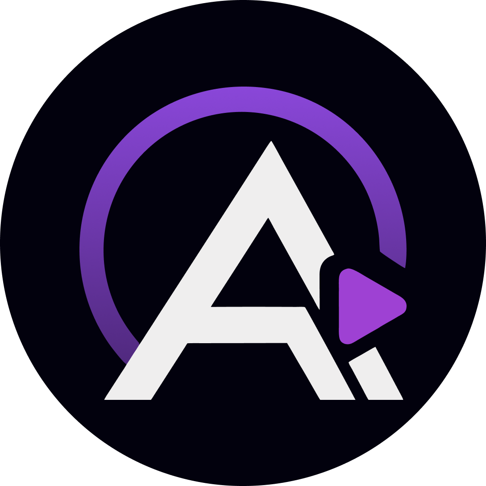
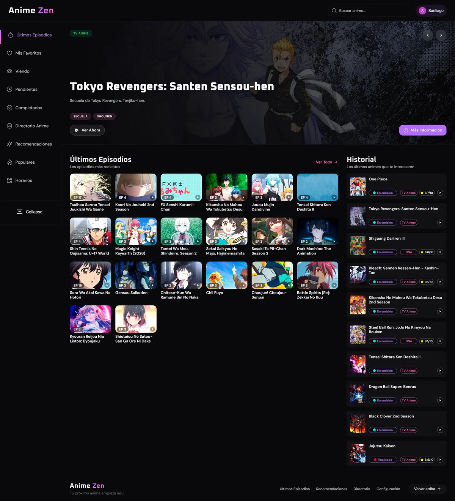
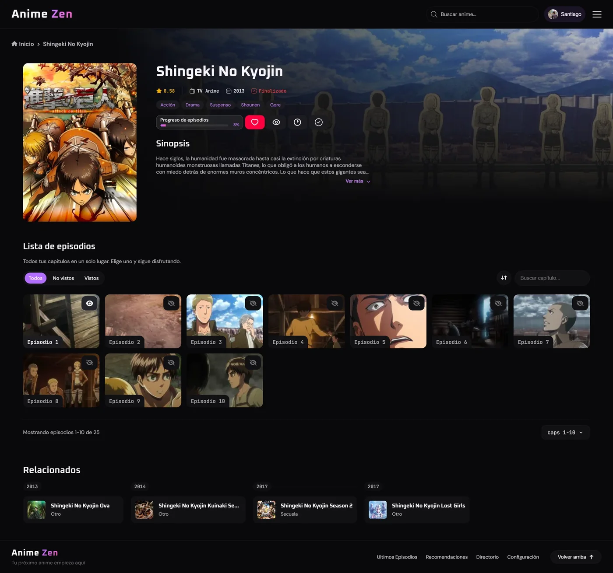
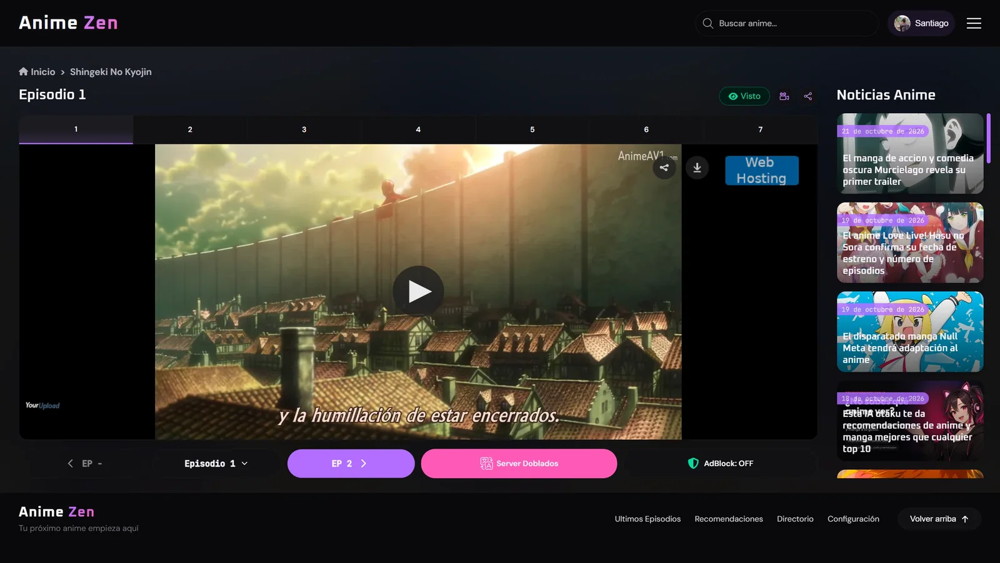
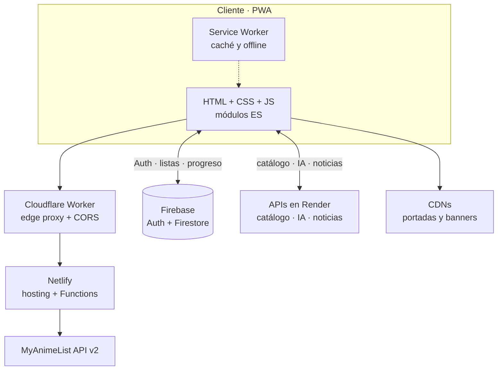

<div align="center">



<h1>AniZen</h1>

<p><strong>Tu próximo anime empieza aquí.</strong><br>
Un cliente de streaming de anime en español, rápido, oscuro y con alma de app nativa.</p>

<p>
  <a href="https://ani.zenlite.workers.dev/"></a>
  <a href="https://github.com/SantiagoCN69/Anime-FLV-LITE"></a>
  <a href="manifest.json"></a>
  <a href="https://firebase.google.com/"></a>
  <a href="scripts/"></a>
  <a href="https://github.com/SantiagoCN69/Anime-FLV-LITE"></a>
</p>

<p><sub>HTML + CSS + JavaScript · sin frameworks · sin build step · PWA</sub></p>

</div>

---

**AniZen** —la marca que la interfaz muestra como **Anime Zen**— reúne catálogo, horarios, rankings, noticias y un reproductor con servidores redundantes en una sola experiencia. El repositorio conserva el nombre histórico **Anime-FLV-LITE**; la marca y el producto actuales son **AniZen**.

No es un servicio de alojamiento: es una capa de descubrimiento y reproducción que organiza enlaces de terceros y los presenta en un reproductor limpio, con seguimiento de progreso y recomendaciones asistidas por IA. Todo el frontend es estático; la inteligencia vive en Firebase, Netlify Functions, Cloudflare Workers y un conjunto de APIs propias.

> **En una frase:** la velocidad de un sitio estático, la profundidad de una base de datos y la sensación de una app nativa.

## 📸 Vista previa

<p align="center">
  <a href="docs/screenshots/inicio.webp">
    
  </a>
</p>

<p align="center"><sub><strong>Inicio</strong> · hero slider, últimos episodios, historial y navegación lateral.</sub></p>

<table>
  <tr>
    <td width="50%" valign="top">
      <a href="docs/screenshots/detalle.webp">
        
      </a>
      <p align="center"><sub><strong>Detalle</strong> · progreso, sinopsis, episodios y relacionados.</sub></p>
    </td>
    <td width="50%" valign="top">
      <a href="docs/screenshots/reproductor.webp">
        
      </a>
      <p align="center"><sub><strong>Reproductor</strong> · servidores, noticias y navegación de episodios.</sub></p>
    </td>
  </tr>
</table>

<p align="center"><sub>Haz clic en cualquier captura para verla a tamaño completo.</sub></p>

## ✨ Características

### Descubrimiento

- **Inicio editorial** — hero slider aleatorio desde `banners-slides.json`, con autoplay, flechas, gesto táctil y accesos a «Ver ahora» y «Más información».
- **Últimos episodios** — feed con caché local, Firestore y API; solo vuelve a renderizar cuando los datos cambian.
- **Continuar viendo e historial** — retoma el siguiente capítulo con su barra de progreso y consulta lo último que te interesó.
- **Directorio multi-fuente** — AnimeAV1 y JKAnime en una misma experiencia: filtros por letra, año, género, tipo, estado y orden, paginación y estado en la URL.
- **Horarios** — programación por día de la semana, búsqueda y orden por emisión reciente.
- **Populares** — rankings de MyAnimeList: popularidad, mejor valorados, en emisión, próximos, TV, películas, OVAs, especiales y favoritos.
- **Búsqueda instantánea** — debounce de 300 ms, historial local, cancelación de peticiones con `AbortController` y recomendaciones IA cuando no hay resultados.
- **Noticias** — titulares de anime en la vista del reproductor, con caché en Firestore y respaldo desde la API.

### Reproductor

- **Servidores redundantes** — prioriza JKAnime, YourUpload, Mega y MP4Upload; deja las descargas de MediaFire al final.
- **Subtitulado y doblado** — filtro por audio y preferencia persistente entre sesiones.
- **Auto-fallback** — si el embed no responde en 10 segundos, prueba automáticamente el siguiente servidor.
- **AdBlock de reproductor** — aplica `sandbox` a los iframes para frenar pop-ups y anuncios de los servidores.
- **Modo cine** — oscurece el entorno del video para concentrar la mirada.
- **Navegación completa** — episodio anterior y siguiente, selector en cuadrícula, marcado como visto y precarga del siguiente episodio.
- **Compartir y descargar** — Web Share API y enlaces de descarga cuando el servidor los ofrece.

### Cuenta y datos

- **Inicio de sesión con Google** — Firebase Auth con popup y sesión persistente.
- **Listas personales** — Favoritos, Viendo, Pendientes y Completados.
- **Progreso por episodio** — capítulos vistos, porcentaje, siguiente episodio y sincronización con Firestore.
- **Metadatos enriquecidos** — score, tipo, año, estado, géneros, sinopsis expandible y animes relacionados.
- **Lista de episodios** — filtros de todos / no vistos / vistos, búsqueda, inversión de orden y paginación.
- **Exportación JSON** — descarga una copia de tus listas e historial desde Preferencias.
- **Caché en capas** — `localStorage` con TTL, mapas en memoria, caché del Service Worker y documentos de Firestore.

### Diseño y personalización

- **Cuatro temas** — Anime Zen (por defecto), Nocturno, Sakura y Gris Cian, construidos con variables CSS y persistencia local/remota.
- **Interfaz responsiva** — sidebar colapsable, gestos de deslizamiento, navegación flotante y adaptación a móvil, tablet y escritorio.
- **Movimiento con intención** — View Transitions API entre vistas, iconos que se transforman con GSAP + MorphSVG y tarjetas que aparecen con `IntersectionObserver`.
- **Ahorro de batería** — desactiva las animaciones cuando la batería está al 20 % o menos y el dispositivo no está cargando.
- **Preferencias reales** — posición de «Continuar viendo», ubicación de la paginación, audio preferido, modo cine, AdBlock y limpieza de caché.

### PWA, rendimiento y SEO

- **Instalable** — manifest, iconos, atajos directos y `display: standalone`.
- **Offline** — precache de la shell y las páginas, network-first para navegación, stale-while-revalidate para assets y fallback a `offline.html`.
- **Actualizaciones controladas** — versionado de caché (`v8.6.22`) y limpieza automática de versiones anteriores.
- **Push notifications** — infraestructura lista en el Service Worker para integrar notificaciones.
- **Carga bajo demanda** — cada sección trae su HTML, CSS y JS solo cuando se visita.
- **SEO** — metadatos, Open Graph, Twitter Cards, JSON-LD, canonical, `robots.txt` y `sitemap.xml`.

## 🧱 Stack

| Capa | Tecnología | Rol en AniZen |
| :--- | :--- | :--- |
| **Interfaz** | HTML5 · CSS3 (custom properties, Grid, Flexbox) · JavaScript ES Modules | SPA estática, sin frameworks ni bundler |
| **Datos** | Firebase 11.8 · Authentication + Cloud Firestore | Sesión Google, listas, progreso y cachés |
| **Animación** | GSAP 3.14 + MorphSVGPlugin · View Transitions API · IntersectionObserver | Transiciones, iconos morfables y entrada de tarjetas |
| **PWA** | Web App Manifest · Service Worker | Instalación, offline, push y estrategias de caché |
| **Edge** | Cloudflare Workers | Proxy, CORS y funciones auxiliares |
| **Hosting** | Netlify + Netlify Functions | Sitio estático y proxys (MAL, banners) |
| **APIs** | Servicios en Render | Catálogo, búsqueda, episodios, horarios, IA y noticias |
| **Rankings** | MyAnimeList API v2 | Datos de populares |
| **Formularios** | Formspree | Contacto y reportes |
| **Tipografía** | Oxanium · DM Sans · JetBrains Mono | Identidad visual |

## 🏗️ Arquitectura



**Cómo se carga una sección:**

1. `index.html` actúa como shell: header, sidebar, footer y un `<main>` con secciones vacías.
2. Al navegar, la URL cambia a `?Seccion` y `index.js` inyecta el fragmento HTML correspondiente.
3. `cargarFetch()` añade el CSS y el módulo JS de esa vista solo una vez, bajo demanda.
4. Los datos se resuelven en cascada según la vista: caché local → Firestore → API externa.
5. La transición se anima con View Transitions API y, cuando aplica, con GSAP.

## 🗂️ Estructura del proyecto

```text
Anime-FLV-LITE/
├── index.html                  # Shell SPA y navegación entre secciones
├── anime.html                  # Detalle de anime (vista y fragmento)
├── ver.html                    # Reproductor de episodios
├── directorioav1.html          # Directorio AnimeAV1
├── directoriojk.html           # Directorio JKAnime
├── populares.html              # Rankings de MyAnimeList
├── horarios.html               # Horarios semanales
├── recomendaciones.html        # Recomendaciones con IA
├── preferencias.html           # Ajustes de la aplicación
├── contacto.html               # Contacto, sugerencias y reportes
├── 404.html · offline.html     # Estados de error y sin conexión
├── banners-slides.json         # Slides del hero de inicio
├── manifest.json               # Manifest de la PWA
├── sw.js                       # Service Worker
├── scripts/                    # Módulos ES (vistas, datos y UI)
├── styles/                     # Hojas de estilo por vista
├── firebase/                   # Reglas e índices de Firestore
├── netlify/functions/          # Proxy MAL y medición de banners
├── cloudflare/                 # Worker edge + función banner-peso
├── icons/ · img/               # Iconografía, imágenes y sonidos
├── docs/screenshots/           # Capturas usadas en este README
├── robots.txt · sitemap.xml    # SEO
└── netlify.toml                # Configuración de funciones
```

### Rutas principales

| Ruta | Vista |
| :--- | :--- |
| `/` o `/?Ultimos-Episodios` | Inicio |
| `/?Mis-Favoritos` · `/?Viendo` · `/?Pendientes` · `/?Completados` | Listas personales |
| `/?DirectorioAV1` · `/?DirectorioJK` | Directorios |
| `/?Recomendaciones` | Recomendaciones con IA |
| `/?Populares` | Rankings de MAL |
| `/?Horarios` | Horarios semanales |
| `/?Preferencias` · `/?Contacto` | Ajustes y contacto |
| `/anime?id=...` | Detalle del anime |
| `/ver?id=...&episode=...` | Reproductor |

## 🚀 Empezar en local

### Requisitos

- Un navegador moderno con soporte para módulos ES.
- Python 3 o Node.js para servir la carpeta por HTTP.
- Opcional: Firebase CLI, Netlify CLI y Wrangler para desplegar.

### 1. Clona y sirve

```bash
git clone https://github.com/SantiagoCN69/Anime-FLV-LITE.git
cd Anime-FLV-LITE

# Opción A: Python
python -m http.server 8080

# Opción B: Node
npx serve .
```

Abre la URL que indique la herramienta (por ejemplo, `http://localhost:8080` con Python o `http://localhost:3000` con `serve`). No uses `file://`: los módulos ES, el Service Worker y las rutas limpias necesitan un servidor HTTP.

### 2. Crea la configuración de Firebase

`scripts/firebaseconfig.js` está excluido por `.gitignore`. Créalo con tu propio proyecto:

```js
// scripts/firebaseconfig.js
export const firebaseConfig = {
  apiKey: "...",
  authDomain: "<tu-proyecto>.firebaseapp.com",
  projectId: "<tu-proyecto>",
  storageBucket: "<tu-proyecto>.firebasestorage.app",
  messagingSenderId: "...",
  appId: "...",
  measurementId: "..."
};
```

Activa **Google** como proveedor de autenticación y crea una base de datos **Cloud Firestore**. Sin este archivo, los módulos que importan `firebase-login.js` no arrancan.

### 3. Ten en cuenta los fragmentos

Las páginas `preferencias.html`, `horarios.html`, `directorioav1.html`, `directoriojk.html`, `populares.html`, `recomendaciones.html` y `contacto.html` funcionan como fragmentos dentro del shell. Varias redirigen a producción si se abren directamente. Para desarrollo, navega siempre desde la raíz:

```text
http://localhost:8080/?Preferencias
http://localhost:8080/?Horarios
http://localhost:8080/?DirectorioAV1
http://localhost:8080/?DirectorioJK
http://localhost:8080/?Populares
http://localhost:8080/?Recomendaciones
http://localhost:8080/?Contacto
```

## ⚙️ Configuración

### Firebase

```bash
cd firebase
firebase deploy --only firestore:rules,firestore:indexes --project <tu-proyecto>
```

El proyecto usa Firestore para datos de animes, listas de usuario, progreso, servidores por episodio, últimos capítulos y noticias. Las reglas e índices viven en `firebase/`.

### Netlify Functions

`netlify.toml` ya declara la carpeta de funciones:

```toml
[functions]
  directory = "netlify/functions"
```

- `mal-proxy-v3.js` (local, excluido por Git) — proxy con caché en memoria para la API de MyAnimeList.
- `banner-peso.mjs` — mide el peso de banners remotos con lista blanca de hosts.

Para producción, mueve las credenciales de MAL a variables de entorno de Netlify en lugar de dejarlas en el archivo.

### Cloudflare

- `cloudflare/functions/banner-peso.js` — versión Worker de la medición de banners.
- `cloudflare/worker.js` — proxy edge hacia Netlify con CORS (archivo excluido por `.gitignore`; recrea el tuyo con tu dominio).

### APIs externas

Los endpoints están centralizados en los módulos de `scripts/`. El catálogo, los episodios, los horarios, la IA y las noticias consumen servicios desplegados en Render:

| Servicio | Uso |
| :--- | :--- |
| `backend-animeflv-lite.onrender.com` | Catálogo, búsqueda, detalle, episodios, horarios y últimos estrenos |
| `backend-ia-anime.onrender.com` | Recomendaciones conversacionales |
| `backend-noticias-anime.onrender.com` | Noticias de anime |

> Los planes gratuitos de Render pueden tardar unos segundos en despertar. Por eso la interfaz muestra contadores y mensajes de espera.

## ☁️ Despliegue

### Netlify

1. Conecta el repositorio.
2. Deja el comando de build vacío y publica la raíz (`.`).
3. Confirma la carpeta de funciones (`netlify/functions`, ya declarada).
4. Activa rutas limpias si tu configuración de Netlify no las resuelve por defecto.

### Cloudflare Workers

El dominio de producción se sirve a través de Cloudflare. El worker incluido en el proyecto actúa como fachada y proxy hacia Netlify:

| Entorno | URL |
| :--- | :--- |
| Producción (edge) | [ani.zenlite.workers.dev](https://ani.zenlite.workers.dev/) |
| Espejo Netlify | [anizenlite.netlify.app](https://anizenlite.netlify.app/) |
| Firebase | Proyecto `animeflvlite` |

### Archivos que no se versionan

| Archivo | Motivo | Qué hacer |
| :--- | :--- | :--- |
| `scripts/firebaseconfig.js` | Configuración del proyecto Firebase | Crearlo con tus claves |
| `netlify/functions/mal-proxy-v3.js` | Credenciales de MyAnimeList | Crearlo y usar variables de entorno |
| `cloudflare/worker.js` | Configuración del edge | Recrearlo apuntando a tu dominio |

> La API key web de Firebase no es un secreto de servidor, pero conviene restringirla por dominio en Google Cloud Console. Las credenciales de MAL sí deben tratarse como secretas.

## 🧠 Decisiones de ingeniería

- **Router sin dependencias.** La URL (`?Seccion`) es el estado de navegación; `history.replaceState` y `cargarFetch` evitan recargar la página y mantienen el shell vivo.
- **Caché en cuatro capas.** `localStorage` con TTL de 5 minutos, `Map` en memoria, caché del Service Worker y Firestore como fuente compartida.
- **Degradación elegante.** Timeout de 12 s en listas, fallback de servidor a los 10 s y modo API directa en el reproductor si Firestore agota su cuota.
- **Normalización de datos.** Las APIs no siempre devuelven la misma forma (`title`/`titulo`, `cover`/`image`/`portada`); `crearAnimeCard()` y los normalizadores absorben esa variación.
- **Movimiento con freno.** Las animaciones se pueden desactivar manualmente y se pausan solas con batería baja, sin sacrificar la funcionalidad.
- **Móvil primero de verdad.** Sidebar deslizable, navegación por gestos entre secciones, scroll horizontal en carruseles y controles táctiles.

## ⚠️ Notas y limitaciones

- La disponibilidad del reproductor depende de servidores de terceros; algunos pueden mostrar anuncios aunque el sandbox los reduzca.
- Las APIs en Render pueden experimentar arranques en frío.
- Las reglas de Firestore son abiertas para el catálogo compartido; endurecerlas es una tarea pendiente para producción.
- El proyecto no incluye pruebas automatizadas ni pipeline de CI.
- `manifest.json` aún no declara capturas para la instalación.

## 🗺️ Roadmap

- [x] SPA estática con navegación bajo demanda
- [x] PWA instalable con soporte offline
- [x] Reproductor multi-servidor con auto-fallback
- [x] Listas, progreso y sincronización con Firebase
- [x] Recomendaciones con IA
- [ ] Mover todas las credenciales a variables de entorno
- [ ] Endurecer reglas de Firestore para datos compartidos
- [ ] Añadir pruebas E2E y CI con Playwright + GitHub Actions
- [ ] Declarar capturas en el manifest y mejorar la instalación
- [ ] Auditoría de accesibilidad y soporte de `prefers-reduced-motion`
- [ ] Internacionalización español / inglés

## 🙌 Créditos

- **Diseño y desarrollo:** [Santiago Cardona Nossa](https://github.com/SantiagoCN69)
- **Fuentes de catálogo y metadatos:** [AnimeFLV](https://www3.animeflv.net/), [AnimeAV1](https://animeav1.com/), [JKAnime](https://jkanime.net/) y [MyAnimeList](https://myanimelist.net/)
- **Librerías y recursos:** Firebase, GSAP, Google Fonts (Oxanium, DM Sans, JetBrains Mono) y SVG Repo
- **Inspiración:** la experiencia de los portales de anime de siempre, con una capa de producto moderna

## ⚖️ Aviso legal

AniZen **no aloja ni transmite video**. Los reproductores son embeds servidos por terceros; el proyecto actúa como índice y herramienta de descubrimiento.

Todos los derechos sobre series, películas, imágenes, nombres y marcas pertenecen a sus autores, estudios y distribuidores. AniZen no está afiliado a AnimeFLV, AnimeAV1, JKAnime ni MyAnimeList.

Este es un proyecto educativo y de portafolio. Si eres titular de derechos y deseas retirar un enlace, utiliza la página de [contacto](https://ani.zenlite.workers.dev/?Contacto).

## 📄 Licencia

El código se comparte con fines educativos y de portafolio. No hay una licencia formal en el repositorio; si quieres reutilizar una parte, contacta al autor. Las dependencias, tipografías, iconos y contenidos de terceros conservan sus propias licencias.

<div align="center">

<sub>Hecho con 💜 por <a href="https://github.com/SantiagoCN69">Santiago Cardona Nossa</a> · <a href="https://ani.zenlite.workers.dev/">ani.zenlite.workers.dev</a></sub>

<sub>Si AniZen te sirvió, deja una ⭐ en el repositorio. Ayuda a que más gente lo encuentre.</sub>

</div>
